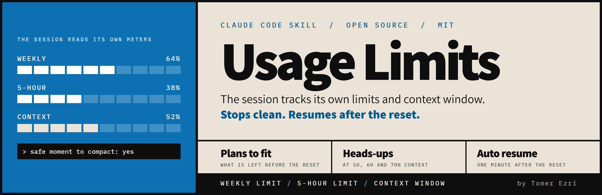
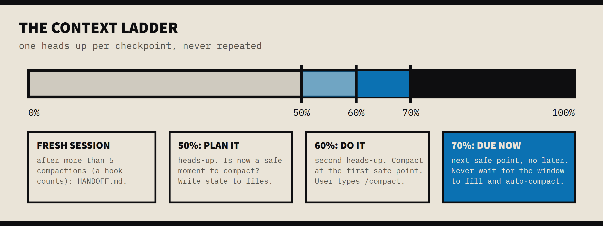
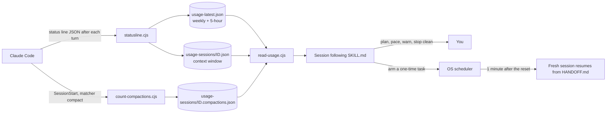
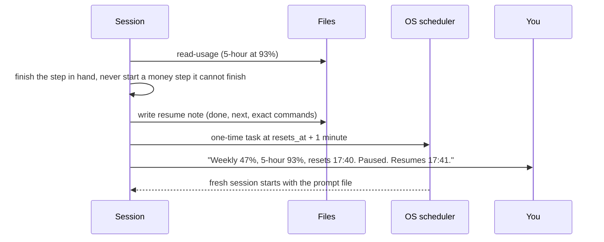

<p align="center">
  
</p>

> **A Claude Code skill that makes the session watch its own usage limits and context window. It plans work to fit what is left, stops at a clean boundary near a limit, arms an automatic resume after the reset, and tells you when to compact.**

*Social preview line: Stop babysitting Claude's limits. The session reads its own weekly limit, 5-hour limit and context window, then paces, stops clean and resumes on time.*

---

## The problem

Long Claude Code sessions fail in four boring ways:

- You start a big task close to the weekly limit and it dies halfway through a database step.
- The 5-hour limit hits while agents are running, and nothing resumes after the reset. You find the session idle hours later.
- The context window fills to 100%, auto-compacts at the worst moment, and the work gets worse before you notice.
- After the sixth compaction the session is working from a summary of a summary, and nobody said so.

In every case the numbers existed. Claude Code just does not hand them to the model. This skill does.

## The concept

1. **The session knows its own numbers.** A status line script saves the weekly limit, the 5-hour limit and this session's context window to small files. A reader script prints them. The user never has to type a percentage.
2. **Plan with what is left.** Before a big task, estimate its cost. If it will not fit before the reset, say so and propose the heavy phase for after it.
3. **Stop at a clean boundary, not mid-step.** At 90-95% of a limit the step in hand finishes and the session stops. A money, database or merge step is never started when the budget cannot finish it.
4. **A resume that exists.** "I'll continue after the reset" means nothing without a scheduled wake-up. The skill arms one, one minute after the reset, and tells you when it fires.
5. **Compact by 70%, on purpose.** Heads-ups at 50, 60 and 70% of the context window, each with a verdict: is now a safe moment to compact? After more than 5 compactions, it recommends a fresh session with a written handoff.

<p align="center">
  
</p>

## Architecture



And the stop-and-resume path near a limit:



## What it looks like

All examples are synthetic.

### What the session reads

```text
$ node skill/scripts/read-usage.cjs
5-hour: 91% used, resets 2026-01-14 18:40
weekly: 47% used, resets 2026-01-17 09:00
account numbers written 2 min ago
context: 58% of the window; compactions so far: 2
```

And the status line it came from:

```text
[Sonnet]  ! 5h:91%  7d:47%  ctx:58%  $4.20
```

### A heads-up at 60% context

> This session's context is at 60%. This is a safe point to compact: nothing is running, the ledger and the handoff file are current. I recommend `/compact` now.

When it is not safe:

> Context is at 60%. Not a safe point yet: two reviewers are still running and will report in a few minutes. I will tell you the moment the window opens.

### A pause near the 5-hour limit

> Weekly 47%, 5-hour 94%, resets 18:40. Finishing the step in hand (migration dry run), then pausing. A one-time task is set for 18:41 to resume from `HANDOFF.md`.

### The sixth compaction

The hook tells the session, and the session tells you:

> This session has now been compacted 6 times. Each compaction keeps only a summary, so detail is being lost. I recommend continuing in a fresh session. I have written `HANDOFF.md` (goal, state, decisions with reasons, open items, next steps). Paste this into a new session: `Read ./HANDOFF.md in full, then continue from its "Next steps".`

## Install

Needs Claude Code and Node 18 or newer.

**1. Copy the skill**

```bash
git clone https://github.com/FuzulsFriend/claude-usage-limits
mkdir -p ~/.claude/skills
cp -r claude-usage-limits/skill ~/.claude/skills/usage-limits
```

PowerShell:

```powershell
git clone https://github.com/FuzulsFriend/claude-usage-limits
Copy-Item -Recurse claude-usage-limits\skill $HOME\.claude\skills\usage-limits
```

**2. Wire the two scripts into `~/.claude/settings.json`** (merge with what you already have; use absolute paths). Template: [`skill/settings.example.json`](skill/settings.example.json).

```json
{
  "statusLine": {
    "type": "command",
    "command": "node /home/you/.claude/skills/usage-limits/scripts/statusline.cjs"
  },
  "hooks": {
    "SessionStart": [
      {
        "matcher": "compact",
        "hooks": [
          { "type": "command", "command": "node /home/you/.claude/skills/usage-limits/scripts/count-compactions.cjs", "timeout": 10 }
        ]
      }
    ]
  }
}
```

On Windows use forward slashes in the paths (`C:/Users/you/.claude/skills/usage-limits/scripts/statusline.cjs`).

Already have a custom status line? Keep it, and copy the two `writeFileSync` blocks from `statusline.cjs` into it. They are what the skill reads.

**3. Check it**

```bash
node claude-usage-limits/tests/run.cjs     # 16 checks on a temp folder, touches nothing of yours
```

Start a new Claude Code session, send one message, then run `node ~/.claude/skills/usage-limits/scripts/read-usage.cjs`. You should see your own numbers.

To keep your files somewhere else, set `CLAUDE_CONFIG_DIR`; all three scripts honour it.

## Use it

It triggers on phrases like "watch the limits", "usage", "weekly limit", "session limit", "context window", "when should I compact", "compact", "pause until reset", "resume after reset" and "continue automatically", and at the start of any multi-step task or before spawning agents.

Things worth saying out loud:

- *"Watch the limits and stop at 95% weekly."* The weekly stop line is yours to set.
- *"Run this overnight. Resume after the reset if you hit the 5-hour limit."* The skill will arm an OS task for it.
- *"Is this a safe moment to compact?"* It answers from what is running, not from a guess.

## The rules it follows

- **Never guess a number.** No file means "I cannot see the limits here" said once, then conservative pacing.
- **A stale reading is not a reading.** The file refreshes only while a session is mid-turn; the reader flags anything older than 15 minutes.
- **No 5-hour limit on your plan?** Then every 5-hour rule is skipped and it paces on the weekly limit and the context window.
- **Resume timers that are not real do not count.** An OS scheduled task is the reliable one. An in-session scheduler is only for while you are at the keyboard (it can silently not fire). Background `sleep` timers are never used.
- **Safe to compact means:** no agent or reviewer about to report, no CI result about to drive a merge, no production or money step half-done, and everything in flight written to files.

## What is in the box

| Path | What it is |
|---|---|
| [`skill/SKILL.md`](skill/SKILL.md) | The skill. Frontmatter plus the rules above in full. |
| [`skill/scripts/statusline.cjs`](skill/scripts/statusline.cjs) | Status line: prints `5h`, `7d`, `ctx`, cost, and writes the two files the skill reads. |
| [`skill/scripts/read-usage.cjs`](skill/scripts/read-usage.cjs) | Prints the numbers (or `--json`), flags stale files, shows reset times in local time. |
| [`skill/scripts/count-compactions.cjs`](skill/scripts/count-compactions.cjs) | SessionStart hook for `compact`: counts compactions per session, escalates above 5. |
| [`skill/settings.example.json`](skill/settings.example.json) | The settings snippet. |
| [`tests/run.cjs`](tests/run.cjs) | Self-test for all three scripts. |
| [`assets/`](assets/) | The banner and the context ladder. |

## Field notes

- **A resume that never happened.** A session said it would resume after the reset and went idle, with nothing scheduled. Now: no pause without an armed wake-up.
- **Timers that never fired.** An in-session scheduler silently did not fire, and the session then guessed why. Now: timed starts that matter use an OS task that was tested end to end, and causes are read from evidence.
- **"Safe to compact" with a stale state file.** A session said it was safe because nothing was running, but its state file was out of date and a decision lived only in chat. Now: write the state down first, then say it.
- **A background `sleep` that was reaped.** Claude Code stops idle background shells under memory pressure. A usage-reset timer built on one died. Now: short commands that exit, and OS tasks for the long waits.

## FAQ

**Does it work on any plan?**
It reads whatever the status line reports. If your plan has no 5-hour limit, it skips those rules. If `rate_limits` is not present at all, the reader says so and the skill paces conservatively.

**Does it burn extra tokens?**
A tiny reader call between phases. The advisor section (a cheaper main model that consults a stronger one at decision points) is optional guidance and usually saves tokens.

**Does the skill compact for me?**
No. A session cannot run `/compact` on itself. It tells you when, and you type it.

**Will the resume really start a new session?**
Only if you set up the OS task it describes; the skill gives the pattern, the lead-loop skill describes the successor handover in full. The tested part of this repo is the three scripts.

## Honest limits

- The status line only refreshes while a session is mid-turn. After a long idle, the numbers are old until the next turn. The reader says so.
- Model names and the advisor pairing rules change between Claude Code versions. The skill tells you to check your own `/advisor` help.
- The wake-up recipes for Windows, macOS and Linux are patterns, not a packaged installer.

## More from the same author

- [claude-lead-loop](https://github.com/FuzulsFriend/claude-lead-loop): one session runs a multi-day program; it reads this skill on every tick.
- [adversarial-review](https://github.com/FuzulsFriend/adversarial-review): a ruthless, severity-ranked review with a binary verdict.

## Author

**Tomer Ezri, Adv.** Lawyer turned AI builder, Tel Aviv. I teach businesses to work with AI, and I teach what I actually build: I solo-built [MarkIt](https://mark-it.co), a live AI capture platform.

[GitHub](https://github.com/FuzulsFriend) / [tomerezri.vercel.app](https://tomerezri.vercel.app)

## License

MIT. See [LICENSE](LICENSE).
